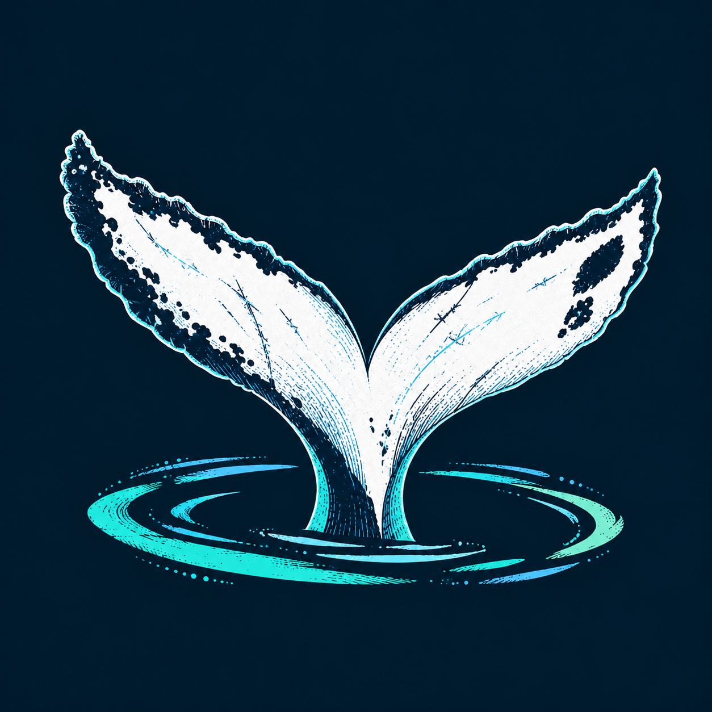
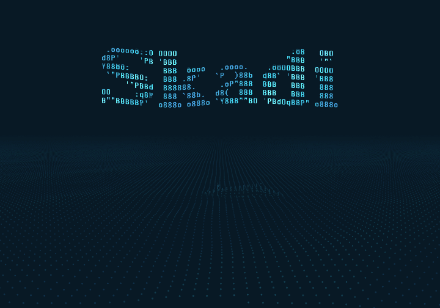
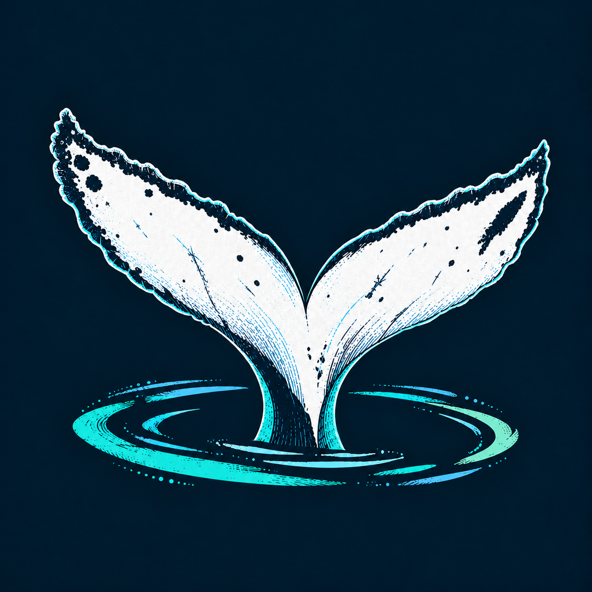
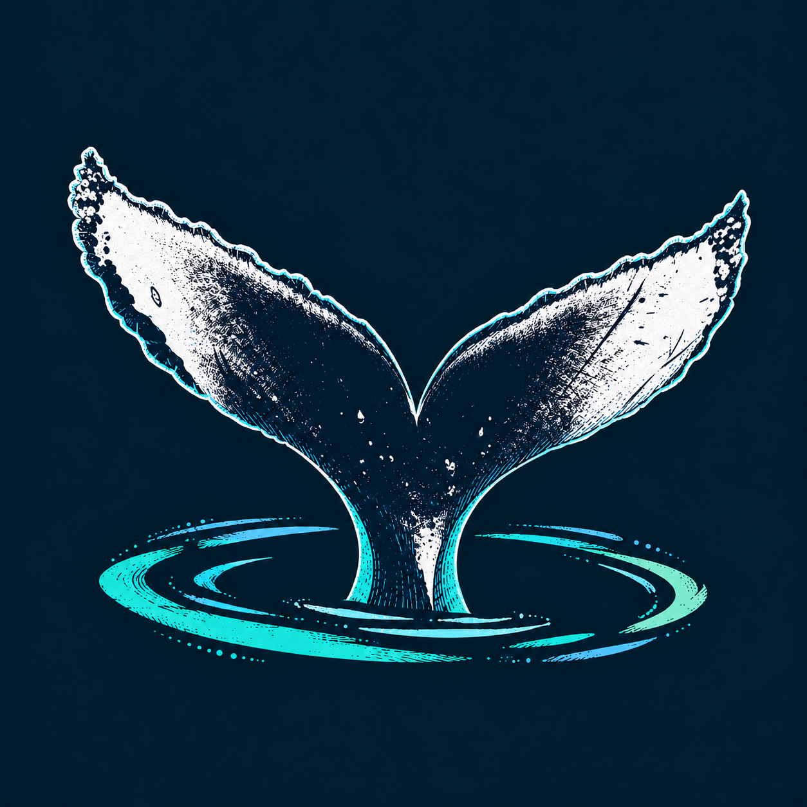
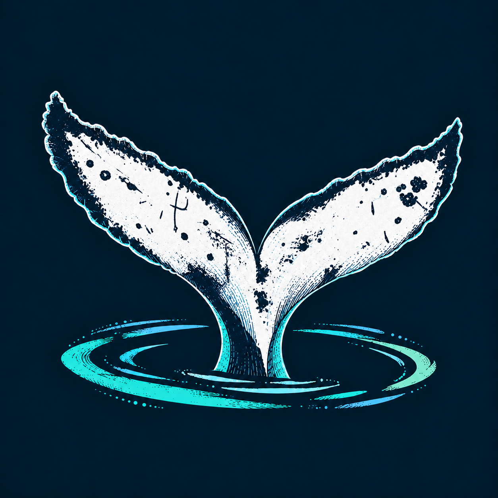
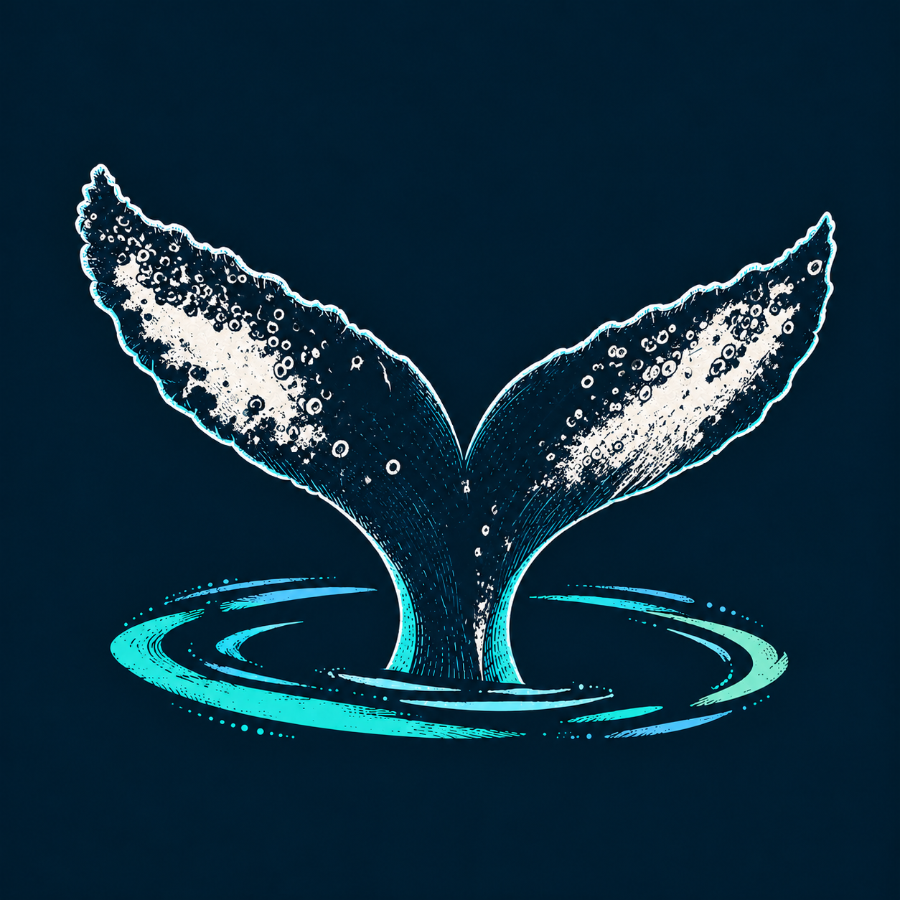

<p align="center">
  
</p>

<h1 align="center">Skadi</h1>

<p align="center">
  <strong>Um oceano entre os seus comandos.</strong><br>
  Um fork do Ghostty com mar em movimento, jubartes e uma identidade para cada janela.
</p>

<p align="center">
  <code>Linux</code> · <code>KDE Plasma</code> · <code>Wayland</code> · <code>Bash</code>
</p>

<p align="center">
  <a href="#a-experiência">A experiência</a> ·
  <a href="#uma-cauda-para-cada-janela">As caudas</a> ·
  <a href="#instalar">Instalar</a> ·
  <a href="#personalizar">Personalizar</a> ·
  <a href="#feito-sobre-o-ghostty">Créditos</a>
</p>

<p align="center">
  <picture>
    <source media="(prefers-reduced-motion: reduce)" srcset="images/skadi/ocean.png">
    
  </picture>
  <br>
  <sub>Prévia renderizada com o shader do projeto. No terminal, o oceano é gerado em tempo real.</sub>
</p>

## A experiência

O Skadi leva uma paisagem oceânica para o terminal: fundo azul profundo,
luz turquesa, ondas de pontos e encontros com jubartes. Cada sessão tem seu
próprio mar, com mudanças suaves de vento, direção e intensidade das ondas.

A base é o **Ghostty**, com suas janelas, abas e painéis. A personalidade do
Skadi aparece na animação, no prompt e nos detalhes que acompanham a digitação.

| Recurso                             | Como aparece no dia a dia                                                                                  |
| ----------------------------------- | ---------------------------------------------------------------------------------------------------------- |
| **Um mar vivo**                     | Ondas procedurais, jubartes que emergem e mergulham, sopros e passagens de gaivotas.                       |
| **Uma abertura que acompanha você** | O editor fica pronto antes da intro. Começar a digitar faz o título sair suavemente enquanto você escreve. |
| **Um prompt em movimento**          | Uma onda percorre usuário, máquina e caminho, com um brilho discreto no `@`.                               |
| **Digitação com cuidado visual**    | Realce de sintaxe com ble.sh, iluminação breve das letras e um rastro suave.                               |
| **Janelas com identidade**          | O ícone original e 20 padrões de cauda ajudam a reconhecer as janelas na barra de tarefas.                 |
| **Integração com o desktop**        | Lançador Skadi, abertura pelo Dolphin, fontes e configuração instalados no seu usuário.                    |

## Uma cauda para cada janela

As marcas das caudas de jubarte inspiram a identidade do Skadi. A primeira
janela usa o ícone original; as seguintes recebem uma das **20 caudas
selecionadas**. Veja algumas delas:

<p align="center">
  
  
  
  
</p>

- **Mesma chance para todas.** O sorteio é uniforme entre as variantes disponíveis.
- **Sem repetição enquanto houver uma livre.** Depois, o sorteio usa as menos ocupadas.
- **A mesma cauda até fechar.** O ícone acompanha a janela durante toda a sessão.

Os ícones individuais na barra foram validados no **KDE Plasma 6 com Wayland**.
Desative o agrupamento de janelas no gerenciador de tarefas para vê-los
separadamente. Esse recurso exige o executável deste fork e suporte do desktop
a ícones por janela; o comportamento em outros ambientes pode variar.

## Instalar

O caminho completo instala o fork, o perfil visual e a integração com o desktop.
A experiência atual é voltada a **Linux com Bash**, especialmente KDE/Wayland.

### Preparar o ambiente

- **Zig 0.16.0**, versão indicada neste checkout em [build.zig.zon](build.zig.zon).
- **Bash 4+, Python 3 e fontconfig** para o perfil e o instalador.
- Dependências de compilação do Ghostty para Linux: GTK 4, libadwaita,
  gtk4-layer-shell, pkg-config, gettext e **blueprint-compiler 0.16.0 ou mais recente**.

Consulte os [pacotes por distribuição](https://ghostty.org/docs/install/build#linux)
e as [orientações para compilar um checkout](HACKING.md#extra-dependencies).
Use a versão de Zig deste repositório, que pode diferir da versão estável do Ghostty.

### Compilar e instalar no seu usuário

```sh
git clone https://github.com/In-Veritas/Skadi.git
cd Skadi
zig build -Doptimize=ReleaseFast
python3 extras/mary/install.py --app-build zig-out
```

Execute o instalador **sem `sudo`**. Ele copia o executável e seus recursos,
instala a fonte Adwaita Mono, configura o perfil e acrescenta blocos
identificados ao `.bashrc`. Os arquivos substituídos recebem um backup datado
em `~/.local/share/mary/backups/`, com um manifesto das alterações.

Abra **Skadi** pelo menu de aplicativos. Se já havia uma instância do
Ghostty/Skadi em execução, encerre o aplicativo completamente depois de salvar
seu trabalho e abra de novo. Fechar apenas as janelas pode manter o processo
anterior em segundo plano.

<details>
<summary><strong>Já tenho Ghostty e quero experimentar apenas o perfil</strong></summary>

Com um Ghostty compatível instalado, execute na pasta do repositório:

```sh
python3 extras/mary/install.py
```

Isso aplica a aparência e a integração Bash ao Ghostty existente. Os ícones
individuais por janela dependem da compilação do fork mostrada acima.
O perfil substitui as fontes e os shaders configurados anteriormente e faz
backup dos arquivos alterados.

</details>

## Personalizar

O perfil reúne a paleta azul/turquesa, Adwaita Mono, o shader do oceano e o
prompt Bash. Os principais arquivos instalados ficam em:

| Arquivo                                     | O que controla                                          |
| ------------------------------------------- | ------------------------------------------------------- |
| `~/.config/ghostty/mary.ghostty`            | Cores, fonte, cursor, espaçamento e ativação do shader. |
| `~/.config/ghostty/shaders/ocean-dots.glsl` | Oceano, baleias, gaivotas e efeitos visuais.            |
| `~/.config/ghostty/mary-shell/`             | Inicialização, prompt e integração com ble.sh.          |

Esses são os caminhos padrão; o instalador também respeita os diretórios XDG.
Recarregue a configuração com **Ctrl + Shift + ,**. Para alterações na
integração Bash, abra uma nova janela. Uma reinstalação reaplica os arquivos do
perfil e guarda as versões anteriores no backup.

<details>
<summary><strong>Por que ainda existem caminhos com o nome Mary?</strong></summary>

Mary foi o nome anterior do projeto. Os caminhos `extras/mary`, `mary-shell`
e `mary.ghostty` foram preservados para manter a compatibilidade com as
instalações existentes. O nome do aplicativo e do repositório é **Skadi**.

</details>

## Conhecer o código

- [Perfil e detalhes técnicos](extras/mary/README.md): animações, integração e verificações.
- [Personalizações do Skadi](extras/mary/overrides/): shader, título e módulos Bash.
- [Instalador](extras/mary/install.py): recursos, backups e integração com o desktop.
- [Seleção das 20 caudas](extras/mary/design/skadi-icons/2026-10-18-caudas-100/selection.json).
- [Aplicativo GTK](src/apprt/gtk/): janelas e integração nativa no Linux.
- [Guia de desenvolvimento](HACKING.md): estrutura e ferramentas herdadas do Ghostty.

## Feito sobre o Ghostty

O Skadi é um fork independente do [Ghostty](https://github.com/ghostty-org/ghostty),
criado por Mitchell Hashimoto e seus colaboradores. O emulador, a renderização
e a infraestrutura de janelas vêm desse projeto. A
[documentação do Ghostty](https://ghostty.org/docs) continua sendo a referência
para os recursos e configurações da base.

O perfil também inclui [ble.sh](extras/mary/payload/share/blesh/doc/README.md)
e a fonte Adwaita Mono, com suas respectivas licenças preservadas.
O código do fork segue a [licença MIT](LICENSE); as licenças do
[ble.sh](extras/mary/payload/share/blesh/licenses/LICENSE.md) e da
[fonte](extras/mary/payload/share/fonts/mary-adwaita-mono/LICENSE) acompanham os recursos.

<p align="center"><sub>Skadi · um terminal com mar próprio.</sub></p>
